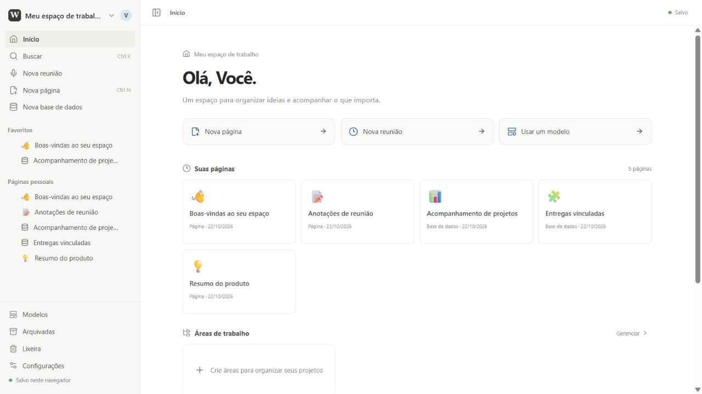
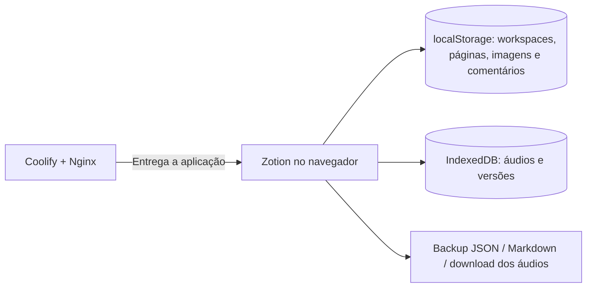

# Zotion — Um REA do Notion

**Páginas, projetos e reuniões em um só lugar. Uma reconstrução web independente do Notion, feita com investigação, código próprio e o REA de Morluto.**

O Zotion transforma um estudo de engenharia reversa em uma aplicação que você pode abrir e usar. Organize vários workspaces, escreva com blocos, acompanhe projetos em bases de dados e grave suas reuniões pelo microfone — em uma interface em português.

### [🚀 Abra o Zotion: notion.hitssdevbox.com.br](https://notion.hitssdevbox.com.br)

**Sem cadastro nesta versão.** Abra, explore os exemplos e crie seu primeiro workspace. Seus dados ficam no navegador e perfil que você está usando.

[Explore os recursos](#o-que-você-já-pode-fazer) · [Conheça a investigação](#da-investigação-ao-produto) · [Execute localmente](#rode-na-sua-máquina) · [Veja o roadmap](#o-que-vem-pela-frente)



## O que você já pode fazer

### 🗂️ Organizar seu trabalho em vários espaços

- **Múltiplos workspaces:** crie, alterne, renomeie e personalize nome, ícone, descrição e tema de cada espaço.
- **Áreas de organização:** reúna páginas por projeto, equipe ou assunto; arquive e restaure áreas sem apagar seu conteúdo.
- **Uma página inicial útil:** encontre páginas recentes, áreas e modelos em um só lugar.
- **Navegação hierárquica:** trabalhe com páginas e subpáginas, favoritos, trilhas de navegação e busca no workspace atual.
- **Movimentação de árvores:** mova ou duplique páginas com suas subpáginas. Transferências entre workspaces preservam os identificadores usados pelos áudios e levam as versões locais.

### ✍️ Escrever com um editor de blocos

Comece a digitar ou use `/` para escolher um bloco. O editor oferece:

| Escrever e estruturar | Conectar e apresentar | Editar com agilidade |
| --- | --- | --- |
| Parágrafos e três níveis de títulos | Imagens locais com legenda | Seleção de vários blocos |
| Listas, numeração e tarefas | Cartões de links HTTP(S) | Copiar, recortar e colar blocos |
| Citações e destaques | Links para páginas e referências de retorno | Duplicar e excluir em lote |
| Código e divisores | Cores de texto e fundo | Reordenar, agrupar e desagrupar |
| Blocos recolhíveis de texto | Sumário com navegação pelos títulos | Atalhos de escrita em Markdown |

Personalize cada página com **seis capas em degradê, três fontes, largura total e texto pequeno**. Ative o bloqueio para evitar edições acidentais.

### 📊 Transformar informações em bases de dados

Uma base, **oito formas de visualizar**:

| Vista | Use para |
| --- | --- |
| **Tabela** | Editar propriedades, agrupar e subagrupar linhas. |
| **Quadro** | Acompanhar o andamento e mover cartões. |
| **Lista** | Consultar registros em uma apresentação compacta. |
| **Calendário** | Ver os registros por data. |
| **Galeria** | Explorar os registros em cartões. |
| **Linha do tempo** | Acompanhar intervalos e prazos. |
| **Gráficos** | Resumir os dados em barras ou rosca. |
| **Formulário** | Cadastrar registros localmente com perguntas configuráveis. |

Crie vistas nomeadas com suas próprias configurações, combine filtros **AND/OR com grupos aninhados até três níveis** e aplique várias ordenações em sequência.

As propriedades incluem texto, número, seleção, seleção múltipla, data, checkbox, URL, e-mail, telefone, pessoa em texto simples, relações locais de uma via, **rollups e fórmulas**. O motor de fórmulas é próprio: interpreta um subconjunto de expressões com `prop("Nome")`, operadores e funções de texto, matemática e datas, sem executar JavaScript arbitrário.

Os formulários permitem configurar perguntas visíveis e obrigatórias, descrições e mensagem de confirmação. As respostas criam linhas na base do navegador atual.

### 🎙️ Preparar e registrar reuniões

Use **Nova reunião** ou o comando `/meet` para reunir:

- Pauta e participantes.
- Gravação local pelo microfone, com pausa e retomada.
- Reprodução, download e exclusão dos trechos gravados.
- Campo de transcrição editável.
- Resumo e decisões editáveis.
- Itens de ação com responsáveis e conclusão.

A gravação depende da confirmação de autorização dos participantes e da permissão de microfone do navegador. O botão de rascunho de resumo usa regras locais sobre a transcrição digitada ou colada. **Não há transcrição automática nem envio de áudio para serviços de IA.**

### 🕘 Recuperar, comentar e reutilizar

- **Lixeira pesquisável:** consulte e restaure páginas com subpáginas. A exclusão definitiva pede confirmação e remove os dados associados.
- **Arquivo separado da lixeira:** retire páginas da rotina e restaure quando precisar.
- **Histórico local:** até 20 versões por página, com prévia, salvamento manual e restauração que preserva uma versão do estado substituído.
- **Comentários locais:** registre observações, responda, edite, resolva e reabra conversas.
- **Sete modelos originais:** reunião, plano de projeto, wiki, planejamento semanal, diário, tarefas e notas de estudo.
- **Seus próprios modelos:** salve uma página ou base como estrutura reutilizável.
- **Importação e exportação:** backup JSON de um workspace ou de todo o catálogo, importação de Markdown/texto e exportação de páginas em Markdown.

## Experimente em um minuto

1. Acesse **[notion.hitssdevbox.com.br](https://notion.hitssdevbox.com.br)**.
2. Explore as páginas e bases de exemplo ou crie um workspace pelo seletor no canto superior esquerdo.
3. Abra **Modelos** e comece com uma reunião, um projeto ou uma wiki.
4. Use `/` no editor, experimente as vistas de uma base e personalize sua página pelo menu de opções.
5. Exporte um backup nas configurações para levar uma cópia do seu conteúdo.

Atalhos para começar: **Ctrl K** abre a busca; **Ctrl N**, fora de um campo de edição, cria uma página; **Esc** fecha os painéis.

## Da investigação ao produto

O nome diz de onde o projeto veio: **Zotion — Um REA do Notion**.

O estudo utilizou o **[REA — Reverse Engineer Anything, de Morluto](https://github.com/morluto/rea)** para analisar o pacote Electron instalado do Notion Desktop e amostras dos bundles JavaScript da interface web. A investigação incluiu inventário do aplicativo, APIs expostas pelo preload, pistas de IPC, clipboard, SQLite, navegação e identificadores relacionados ao editor e às bases de dados.

A implementação combina três fontes de trabalho:

| Fonte | Papel no Zotion |
| --- | --- |
| **Análise estática com REA** | Identificar estruturas, membros, rótulos e limites do material analisado. |
| **Observação da interface e documentação pública** | Entender os comportamentos visíveis que orientam a reconstrução. |
| **Código original deste projeto** | Criar o editor, as bases, a persistência local e os fluxos da aplicação web. |

Encontrar um nome em um bundle não demonstra como o recurso funciona internamente. Por exemplo, o traço de `workspaceSwitcher` identificou o membro, mas não resolveu o fluxo interno de troca de workspace. O catálogo e as regras de organização do Zotion são uma implementação própria.

**Este é um projeto independente, sem afiliação com o Notion.** O repositório contém o código original da aplicação e os relatórios do estudo. O pacote do Notion, bundles extraídos, saídas brutas do REA, páginas da conta do usuário e credenciais não são distribuídos aqui.

Para conhecer o método, as evidências e as perguntas que continuam abertas:

- **[Relatório de engenharia reversa](docs/engenharia-reversa.md)** — cobertura do desktop e dos bundles web, decisões e limites.
- **[Investigação de workspaces](docs/workspace-investigation.md)** — evidência REA, comportamentos documentados e critérios adotados na reconstrução.

## Como seus dados são armazenados

O Zotion atual funciona **localmente no navegador**. O domínio público entrega a aplicação; não recebe suas páginas ou gravações em um servidor de dados.



- Cada navegador e perfil tem seus próprios dados. Abrir o domínio em outro dispositivo não sincroniza o conteúdo.
- O nome do perfil identifica comentários locais; não é uma conta autenticada. Áreas e bloqueios de edição não implementam permissões entre usuários.
- O backup JSON inclui conteúdo, imagens e comentários. **Histórico de versões e arquivos de áudio ficam de fora**; os áudios podem ser baixados pelo bloco de reunião.
- Importar JSON adiciona novos workspaces e preserva os anteriores. A migração do formato antigo conserva os IDs de páginas e blocos.
- Duplicação e modelos criam novos IDs e não copiam gravações, comentários ou versões. Transferir uma árvore entre workspaces exige resolver vínculos com páginas que ficariam no espaço de origem.
- Imagens locais aceitam PNG, JPEG, WebP e GIF de até **512 KiB**. Cartões de links não buscam metadados externos.
- Limpar os dados do navegador pode apagar o conteúdo local. Exporte os dados que deseja guardar.

## O que vem pela frente

O projeto já oferece um conjunto amplo de recursos locais. A paridade completa com o Notion permanece um trabalho em evolução.

- [x] Workspaces, áreas, navegação e configurações.
- [x] Editor de blocos e oito vistas de bases de dados.
- [x] Propriedades, relações locais, rollups e fórmulas.
- [x] Gravação de reuniões pelo microfone.
- [x] Lixeira, arquivo, comentários e versões locais.
- [x] Modelos, aparência e importação/exportação.
- [ ] Autenticação e persistência no servidor.
- [ ] Membros, convites e permissões efetivas.
- [ ] Sincronização entre dispositivos e colaboração em tempo real.
- [ ] Comentários compartilhados e notificações.
- [ ] Transcrição automática, identificação de falantes e integrações de calendário.
- [ ] Formulários públicos com coleta centralizada.
- [ ] Backup único com histórico e mídia.
- [ ] Linguagem completa de fórmulas, relações inversas, modelos recorrentes, feeds e mapas.

## Rode na sua máquina

**Stack:** React 19 · TypeScript 6 · Vite 8 · Lucide · localStorage · IndexedDB.

Requer Node.js 24 ou uma versão compatível com Vite 8.

```bash
git clone https://github.com/jocarvalhosantos/Zotion.git
cd Zotion
npm ci
npm run dev
```

Para gerar a aplicação estática:

```bash
npm run build
npm run preview
```

A análise estática do código está disponível com `npm run lint`.

### Docker e Coolify

```bash
docker build -t zotion .
docker run --rm -p 8080:80 zotion
```

O `Dockerfile` usa Node para compilar e Nginx para servir a aplicação como SPA na porta `80` do container. Esta versão não exige variáveis de ambiente, chaves de API ou um banco de dados no servidor.

A implantação pública está no **Coolify**, em **[https://notion.hitssdevbox.com.br](https://notion.hitssdevbox.com.br)**.

### Encontre o código

| Arquivo | Responsabilidade |
| --- | --- |
| `src/App.tsx` | Interface principal, navegação e integração dos fluxos. |
| `src/workspaces.ts` | Catálogo, migração, movimentação, lixeira e importação de workspaces. |
| `src/BlockEditor.tsx` e `src/EditorExtensions.tsx` | Editor e tipos de blocos. |
| `src/DatabaseView.tsx` e `src/formulas.ts` | Vistas, propriedades e cálculos das bases. |
| `src/MeetingNotesBlock.tsx` e `src/meetingAudioStore.ts` | Reuniões e gravações locais. |
| `src/PagePanels.tsx` e `src/pageHistory.ts` | Comentários e histórico de versões. |
| `src/templates.ts` e `src/pageExport.ts` | Modelos, importação de texto e exportação Markdown. |
| `docs/` | Relatórios da investigação e material de apresentação. |

## Participe da evolução

Encontrou um problema ou sentiu falta de um fluxo? **[Abra uma issue](https://github.com/jocarvalhosantos/Zotion/issues)** com o comportamento esperado, o que aconteceu e os passos para reproduzir. Contribuições pelo código também são bem-vindas por pull request.

Se a ideia te interessou, **deixe uma estrela no repositório e compartilhe a demonstração**.

---

Criado por **[Jonas Santos](https://github.com/jocarvalhosantos)**, com **[REA, de Morluto](https://github.com/morluto/rea)**, como ferramenta de investigação. Referências complementares: [estudo público do REA sobre o Notion](https://rea.tools/showcase/notion/) e [documentação oficial do Notion](https://www.notion.com/help).

**[Abra o Zotion →](https://notion.hitssdevbox.com.br)**
