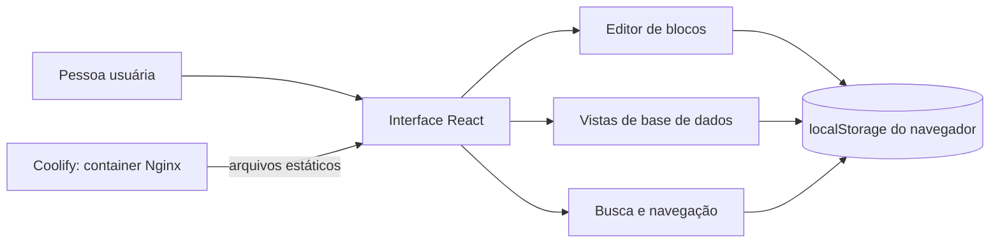

# Engenharia reversa: método, evidências e limites

## Objetivo e escopo

Este estudo usa o REA (Reverse Engineer Anything), mantido por Morluto, para observar o pacote Electron instalado do Notion Desktop. O alvo foi o `app.asar` empacotado com o aplicativo; não foram extraídos dados da conta, páginas do usuário, tokens ou credenciais. A interface web do Notion redirecionou para autenticação durante a inspeção e não foi automatizada. Assim, as conclusões sobre o cliente online são limitadas à documentação pública do Notion e ao estudo público do REA.

O resultado é um mapa estático parcial e uma aplicação independente que reproduz um conjunto pequeno de padrões de interação. Não é uma implementação da API do Notion nem uma cópia integral do produto.

## Ferramenta e artefato

- Projeto: [morluto/rea](https://github.com/morluto/rea), CLI `rea-agents` 6.7.0.
- Operações: `inspect_artifact` e `analyze_javascript_application`.
- Formato: ASAR, aplicativo Electron.
- SHA-256 da raiz do artefato: `afb4684fa08d12d7ccd3c89e2ad195de7047859d437e721689a5cbfc69403549`.
- Política de integridade: `record-and-continue`, pois o inventário encontrou cinco contradições entre metadados de integridade e bytes observados em módulos nativos desempacotados. Esses bytes foram marcados como não confiáveis e não sustentam conclusões de equivalência.

Os arquivos `.asar` e os relatórios brutos são evidência local de trabalho e não são publicados junto com o código.

## O que o REA observou

Na análise do pacote desktop, o REA reportou:

- 268 nós, 284 ocorrências e 283 arestas no inventário do artefato;
- 161 arquivos relevantes, 90 arquivos JavaScript analisados, 8 ignorados, 2.789 módulos e 1.749.894 nós AST visitados;
- 8.520 achados e zero falhas de parse nos arquivos que o analisador conseguiu processar;
- 14 definições de janelas de navegador e 41 preferências explícitas para conteúdo web;
- 20 APIs de `contextBridge` com 282 membros expostos;
- 26 operações IPC observadas, entre elas 7 canais literais, 13 operações com canal dinâmico, 10 handlers no processo principal e 5 pares de envio/recepção reconhecidos;
- 2 processos utilitários observados.

Essas contagens descrevem achados da análise estática do artefato e não significam que cada fluxo foi executado ou compreendido por completo. O grafo semântico ficou marcado como parcial e truncado, com 164 limitações registradas. O orçamento de análise e a memória disponível impediram a análise semântica completa de alguns bundles grandes. O relatório completo foi mantido fora do repositório porque contém evidência extensa derivada do aplicativo instalado.

## Modelo de produto adotado

O pacote desktop é uma camada Electron com janelas e comunicação entre processos. Isso, por si só, não descreve os serviços web, a persistência remota ou os protocolos internos do Notion. Para as partes visíveis ao usuário, o estudo foi combinado com a documentação oficial:

- As páginas são compostas por blocos e a interface documenta a inserção de blocos por comandos `/`.
- Bases de dados têm propriedades tipadas e várias vistas; a documentação cobre tabela, quadro, lista, calendário, galeria, cronograma, gráfico, mapa, feed e formulários.
- A busca oferece atalhos e consultas no espaço de trabalho e em bases de dados.

O modelo de dados da aplicação contém páginas, blocos, referências hierárquicas, favoritos e linhas de base de dados. A implementação oferece vistas de tabela, quadro, lista e calendário. As mudanças são salvas no navegador.

## Escopo implementado e lacunas

Implementado nesta versão: navegação hierárquica, favoritos, edição de blocos, comandos de inserção, tarefas com checkbox, bases com quatro vistas, propriedades básicas, busca local, filtro/ordenação, tema claro/escuro e backup JSON.

Fora do escopo: login, sincronização, colaboração em tempo real, permissões, comentários, integrações, API do Notion, anexos, propriedades avançadas, fórmulas, rollups, filtros combinados, vistas persistentes, relacionamento entre bases e paridade visual/comportamental completa. Não há serviço de backend; perfis de navegador não compartilham dados.

## Referências

- [Repositório REA](https://github.com/morluto/rea)
- [Estudo de caso REA do Notion Desktop](https://rea.tools/showcase/notion/)
- [Noções básicas de escrita e edição no Notion](https://www.notion.com/help/writing-and-editing-basics)
- [Vistas, filtros e ordenação no Notion](https://www.notion.com/en-gb/help/views-filters-and-sorts)
- [Propriedades de bases de dados no Notion](https://www.notion.com/help/database-properties)
- [Busca no Notion](https://www.notion.com/en-gb/help/search)
