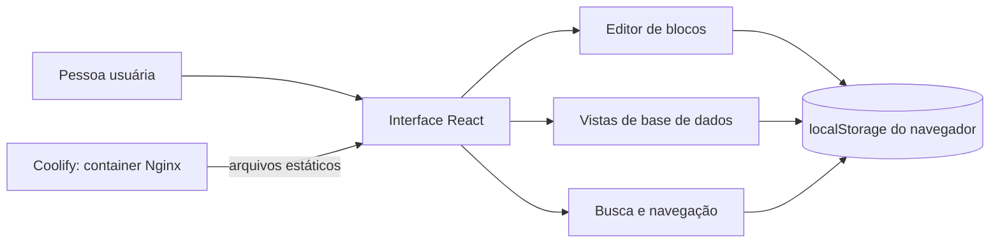

# Engenharia reversa: método, evidências e limites

## Objetivo e escopo

Este estudo usa o REA (Reverse Engineer Anything), mantido por Morluto, para observar o pacote Electron instalado do Notion Desktop e uma amostra pública dos bundles web. O alvo local foi o `app.asar` empacotado com o aplicativo; não foram extraídos dados da conta, páginas do usuário, tokens ou credenciais. A interface web exigiu autenticação para capturar os bundles completos; a aba autenticada foi observada somente por leitura da árvore de acessibilidade, sem interação. O REA não se conectou à sessão autenticada nem capturou tráfego em runtime. Assim, as conclusões sobre o cliente online também se apoiam na documentação pública do Notion e no estudo público do REA.

O resultado é um mapa estático parcial e uma aplicação independente que reproduz um conjunto pequeno de padrões de interação. Não é uma implementação da API do Notion nem uma cópia integral do produto.

## Ferramenta e artefato

- Projeto: [morluto/rea](https://github.com/morluto/rea), CLI `rea-agents` 6.7.0.
- Operações: `inspect_artifact` e `analyze_javascript_application`.
- Formato: ASAR, aplicativo Electron.
- Manifesto `/package.json` do mesmo ASAR: Notion Desktop `7.40.0`; versão declarada de `electron`: `44.9.1`.
- SHA-256 da raiz do artefato: `afb4684fa08d12d7ccd3c89e2ad195de7047859d437e721689a5cbfc69403549`.
- Política de integridade: `record-and-continue`, pois o inventário encontrou cinco contradições entre metadados de integridade e bytes observados em módulos nativos desempacotados. Esses bytes foram marcados como não confiáveis e não sustentam conclusões de equivalência.

Os arquivos `.asar` e os relatórios brutos são evidência local de trabalho e não são publicados junto com o código.

## O que o REA observou

Na análise do pacote desktop, o REA reportou:

- 268 nós, 284 ocorrências e 283 arestas no inventário do artefato;
- 161 arquivos relevantes, 90 arquivos JavaScript analisados, 8 ignorados, 2.789 módulos e 1.749.894 nós AST visitados;
- 8.520 achados e zero falhas de parse nos arquivos que o analisador conseguiu processar;
- 14 definições de janelas de navegador e 41 preferências explícitas para conteúdo web;
- 20 APIs de `contextBridge` com 282 membros expostos;
- 26 operações IPC observadas, entre elas 7 canais literais, 13 operações com canal dinâmico, 10 handlers no processo principal e 5 pares de envio/recepção reconhecidos;
- 2 processos utilitários observados.

Essas contagens descrevem achados da análise estática do artefato e não significam que cada fluxo foi executado ou compreendido por completo. O grafo semântico ficou marcado como parcial e truncado, com 164 limitações registradas. O orçamento de análise e a memória disponível impediram a análise semântica completa de alguns bundles grandes. O relatório completo foi mantido fora do repositório porque contém evidência extensa derivada do aplicativo instalado.

## Achado focado: área de transferência

Uma leitura focada do Evidence `ev_33033f169f7b21d9c6d067ba341f8c2ec59c53049f2ef0634171c19767d58122` encontrou, no arquivo `.webpack/renderer/tab_browser_view/preload.js`, dois caminhos estáticos candidatos:

- `__electronApi.copyImage` termina em `navigator.clipboard.write`; o caminho contém condições estáticas, mas a análise não prova que ele foi executado.
- `__electronApi.copyText` termina em `navigator.clipboard.writeText`.

Confirmei o resultado com uma segunda execução REA, Evidence `ev_df7197a36039e07bb30b08af956484cb53304ba6a5ca597a03fcab66dc6fa894`, selecionando somente esse preload. O REA leu 401.659 bytes, visitou 93.657 nós AST, analisou 126 módulos e registrou 270 achados, 5 APIs `contextBridge` e 232 membros expostos. A seleção deixou 160 arquivos sem análise. Portanto, a ausência de handlers de processo principal neste resultado focado é desconhecida, não evidência de ausência no aplicativo. Os dois caminhos de clipboard continuaram marcados como candidatos.

O REA marcou ambos como `candidate`. Isso confirma as expressões observadas no pacote, mas não identifica o chamador em tempo de execução nem o payload completo, o formato rico, as permissões efetivas ou o fluxo de colagem. O achado não autoriza concluir que o Notion instalado use o mesmo protocolo do estudo público.

O [estudo de caso público do REA sobre a área de transferência do Notion](https://rea.tools/showcase/notion/) descreve uma trilha analisada em Notion Desktop `7.6.1`: texto e HTML no clipboard, um identificador no HTML e dados estruturados mantidos localmente para restaurar blocos quando esse identificador ainda existe. O artefato instalado aqui é `7.40.0`, portanto essa trilha anterior serve como referência conceitual e não prova o comportamento exato desta versão. Os dois fluxos não foram tratados como equivalentes.

### Escolha de reconstrução nesta aplicação

A aplicação implementa seu próprio formato: copia o texto simples e uma representação HTML com um marcador `workspace-lab:<id>`, mantendo o bloco estruturado em memória na sessão atual. Ao colar a partir desse marcador na mesma sessão, restaura o tipo e o conteúdo do bloco; se a cópia vier de outro aplicativo, de outra sessão ou não tiver HTML, o navegador usa texto simples. O marcador e o formato não reutilizam IDs nem MIME types do Notion. Esta é uma decisão de implementação inspirada na evidência e não uma alegação de paridade.

## Limite do preload de navegação

A API `__electronApi` do preload contém 232 membros inferidos estaticamente; entre eles estão `navigateToBlock`, `navigateToBlockInTab`, `setActiveBlocks`, `copy`, `paste`, `quickSearchRefresh` e métodos de abas e SQLite. Uma análise REA com orçamento ampliado, Evidence `ev_336da38de67ef3d5fd46074f61a437f996adf5c89daf99408eff72c33f7888f3`, reteve 50.097 nós e 46.258 relações semânticas no preload selecionado, mas ainda ficou parcial e truncada, com 20.809 incógnitas e 160 arquivos fora da seleção.

O traço de `navigateToBlock`, Evidence `ev_a41648e8bbe99080688d49bba0e3c34b72cf95e4e24572a83a019baecc1d571e`, encontrou o nome como membro de `__electronApi`, mas retornou somente um nó, zero arestas e nenhum caminho terminal. Portanto, há evidência do nome exposto no preload; o destino, o chamador e a navegação de página não foram resolvidos. A API não foi tratada como prova de comportamento em execução.

## Achado focado: processo principal e IPC

Analisei o arquivo `.webpack/main/index.js` isoladamente, usando o mesmo `app.asar` e SHA-256. Evidence da análise: `ev_b4b769964d7bbfdf7575052b2cb0d4790ae5d3e4a28561e850d946c222061ef8`. O REA processou um arquivo selecionado, leu 4.411.723 bytes de texto, visitou 966.691 nós AST, reconheceu 1.796 módulos e registrou 6.020 achados, sem falhas de parse. Os outros 160 arquivos inventariados ficaram fora dessa seleção.

Nesse arquivo, o resumo estático registra 14 definições de `BrowserWindow`, 41 preferências explícitas de conteúdo web, 11 operações IPC, 10 listeners/handlers no processo principal, 3 canais literais, 7 operações com canal dinâmico, 5 observações de validação de remetente e 2 processos utilitários (um com ponto de entrada resolvido). O grafo de aplicação e o grafo semântico continuam parciais; a análise manteve 155 incógnitas de aplicação e 21.164 incógnitas semânticas. Os números não provam execução nem cobertura dos arquivos não selecionados.

Um traço estático do canal literal `electron-store-get-data` (Evidence `ev_fe5228900f6677fadb0a811237762fffbe4a3fb4e715fa6345a69b80563d7185`) encontrou uma transmissão síncrona identificada como renderer e um listener `on` no processo principal. A ligação foi classificada com confiança alta pelo REA. Os outros dois canais literais observados foram `migration-dump-done` e `migration-restore-done`. Entre os canais dinâmicos aparecem expressões `t.createKey("start")`, `t.createKey("scope")`, `t.createKey("envelope")`, `t.createKey("structured-log")`, `t.createKey("metric")`, `t.createKey("status")` e `e`; seus valores e pareamentos permanecem desconhecidos.

O traço em ambas as direções alcançou 2.523 nós por causa de relações de contenção no bundle. A conclusão acima usa apenas as duas arestas diretamente ligadas ao canal selecionado; os demais nós do traço não foram tratados como participantes desse fluxo. Isso ainda não mostra o valor lido pelo handler, persistência de páginas, sincronização remota nem comportamento em execução.

## Fronteira do cliente web e carregamento de telas

Fiz uma passada adicional do processo principal com o mesmo artefato, selecionando somente `.webpack/main/index.js` e elevando os limites semânticos para 50.000 nós e 40.000 por arquivo. O Evidence REA é `ev_96f1d1d4824142ea4eeb6dab14bed0abf69cf31e3d51d40facae2064ae1886bb`; a projeção de resumo é `ev_edcde5735f2a6ab3a585ee799a7e3386387f066462aa8529b638bd016b252c5a`. Foram analisados 966.691 nós AST, 1.796 módulos e 6.020 achados, sem falhas de parse. Ainda assim, 160 arquivos ficaram fora da seleção, o grafo semântico ficou parcial e truncado, e o relatório reteve 41.164 incógnitas semânticas. O limite maior expôs mais incógnitas; não converteu candidatos estáticos em comportamento confirmado.

No código estático desse processo, a janela principal chama `webContents.loadURL(this.initialUrl)`. Outras rotas montam URLs usando `getInitialBaseUrl()`, incluindo `/quick-search`; há também carregamento de páginas internas de abas e placeholders por caminhos `file://`. A busca textual no mesmo arquivo encontrou URLs explícitas para serviços auxiliares, como `https://calendar.notion.so`, mas não resolveu o valor usado em `initialUrl` nem a origem retornada por `getInitialBaseUrl()`.

O inventário do ASAR lista componentes internos para abas, configurações, atividade, SQLite e janelas. Em `.webpack/renderer/tab_browser_view`, o único arquivo listado é `preload.js`, sem um `index.js` de interface. Isso sugere que o conteúdo principal é entregue ao contêiner de navegação em tempo de execução, mas não prova qual origem, bundle web ou endpoint foi carregado. Sem uma captura de runtime da navegação e dos recursos da aplicação, a interface autenticada, os modelos de página e as chamadas ao backend continuam fora do que este pacote permite confirmar.

### Passada estática sobre o shell web publicado

Em 22/10/2026, obtive sem autenticação o shell público de `https://app.notion.com/` e baixei 14 arquivos JavaScript servidos pelo mesmo domínio. Mantive o shell e os bundles fora do repositório. O snapshot dos bundles tem SHA-256 `68856928394d3bddad466165e9cceb04611ce4d56470aeaddecfac0ec80dbde2`.

O Evidence REA `ev_83b838be79874ba01338daa896702971875de3d84c3c54ea611cb99e829777d2` inventariou 14 arquivos, leu 5.837.728 bytes de texto, analisou 12 arquivos JavaScript e registrou 1.125 módulos, 522.032 nós AST, 11.488 achados e zero falhas de parse. O grafo semântico ficou parcial e truncado, com 34.956 incógnitas; dois arquivos passaram do orçamento de análise semântica e um bundle de 3,7 MB excedeu o limite de fatos estáticos completos. Essa amostra representa apenas os assets referenciados pelo shell público naquele momento; não inclui todos os chunks sob demanda, dados de uma sessão autenticada ou um número de versão do produto.

Para aprofundar a área de bases, analisei isoladamente `22194-625f5aaea2cefe74.js`, que no snapshot tinha 748.124 bytes. O Evidence REA `ev_98e45834dec295d79482246336a6d2ba0a7ebba9f13cfe3f79d244b1e41fb2aa` registrou 201.876 nós AST, 332 módulos, 5.119 achados e zero falhas de parse. A saída preservou 20.000 nós semânticos, 8.418 relações e 20.000 incógnitas, mas atingiu o teto por arquivo e permaneceu parcial e truncada.

Nesse bundle, o REA reteve referências a `rollupPropertySchema`, `rollup_type`, `rollupType` e `collectionFeatureGates/rollup_empty_value_filter`. Os registros classificam leituras de alguns desses campos como desconhecidas porque o receptor não foi resolvido; portanto, são referências e caminhos candidatos, não prova de estado padrão ou execução. A leitura estática do trecho também expõe campos relacionados a propriedade de pessoa, propriedade-alvo e agregação. Isso reforça a decisão de manter os rollups locais explicitamente tipados, mas não permite afirmar compatibilidade com a implementação interna do Notion.

Na mesma passada focada, procurei caminhos de filtros e vistas. O relatório preservou nomes candidatos como `filters`, `sort`, `viewId`, `propertyFilters`, `combinatorFilter`, `filterValue`, `subfilter` e `subfilterType`. Um trecho minificado percorre `propertyFilters` com `combinatorFilter`, e outro consulta `subfilter` durante avaliação. O grafo REA mantém receptores e várias relações como desconhecidos; esses nomes e trechos não estabelecem o esquema persistido completo, precedência entre grupos ou o comportamento em execução. Usei-os somente como pistas para ampliar o modelo local com grupos de condições AND/OR, sem alegar equivalência interna.

O Chrome do usuário estava aberto no Notion, mas não expunha um endpoint local CDP em `9222` ou `9223`; por isso, o REA CLI não conseguiu capturar os scripts da página autenticada. Não tentei abrir outra sessão de depuração nem reutilizar cookies. A observação da árvore de acessibilidade da página autenticada segue limitada aos controles visíveis descritos abaixo; não houve captura de rede nem execução de cenários.

## Cobertura nesta etapa

| Frente investigada | Estado | Evidência e limite |
| --- | --- | --- |
| Identidade do aplicativo desktop e empacotamento Electron | Respondida parcialmente | Manifesto, versão `7.40.0`, SHA-256 do `app.asar` e inventário REA; não representa todas as versões do Notion. |
| API de clipboard do preload | Respondida parcialmente | Dois caminhos estáticos candidatos para escrita de texto/imagem; chamador, payload rico e colagem em runtime continuam desconhecidos. |
| API exposta pelo preload | Respondida parcialmente | `__electronApi` lista 232 membros; o traço de `navigateToBlock` encontrou o nome, mas nenhum caminho de chamada. O status dinâmico e o comportamento em execução continuam desconhecidos. |
| Processo principal e IPC | Respondida parcialmente | Um canal literal tem transmissão e listener pareados; sete operações têm canal dinâmico e o grafo semântico tem incógnitas. |
| Carregamento do conteúdo principal no desktop | Respondida parcialmente | `initialUrl` e `getInitialBaseUrl()` são usados para carregar conteúdo em `webContents`; a origem e os recursos carregados não foram resolvidos em runtime. Evidence `ev_96f1d1d4824142ea4eeb6dab14bed0abf69cf31e3d51d40facae2064ae1886bb`. |
| Shell e bundles públicos da interface web | Respondida parcialmente | 14 scripts do shell público foram inventariados; REA analisou 12 e reteve referências estáticas a campos de rollup. Os chunks sob demanda, a versão exata, os receptores de propriedades desconhecidos e o comportamento em runtime continuam sem confirmação. Evidence `ev_83b838be79874ba01338daa896702971875de3d84c3c54ea611cb99e829777d2`; foco em bases `ev_98e45834dec295d79482246336a6d2ba0a7ebba9f13cfe3f79d244b1e41fb2aa`. |
| Serviço SQLite do desktop | Respondida parcialmente | Evidence `ev_aaec5886b5fb14bfc6e3ef3cfb80f7c425d3849fe2d8c8dfdbcf1d01555a7a0f` cobre `.webpack/main/SqliteServer.js` e uma referência a `better-sqlite3`; o esquema e a finalidade dos dados não foram estabelecidos. O addon nativo com metadados de integridade contraditórios não sustenta conclusões. |
| Interface visual | Respondida parcialmente | Uma captura da janela aberta mostrou navegação lateral, busca, ações de página e áreas de conteúdo; é uma observação de uma tela, sem verificar os fluxos desses controles. |
| Fluxos de páginas, blocos e bases de dados do produto | Não respondida pelo binário selecionado | A aplicação implementa um subconjunto guiado pela documentação pública; não houve análise focada dos módulos de interface web que implementam esses fluxos. |
| Sincronização, API online, permissões e colaboração | Não respondida | A inspeção estática do desktop não estabelece protocolos de backend nem semântica de conta. |
| Resposta dos controles em execução | Não respondida | A captura visual confirma apenas uma tela renderizada; nenhum clique ou fluxo foi observado. |

### Observação visual complementar

Separada das evidências REA, a leitura visual da janela desktop aberta mostrou um padrão de navegação com busca global, página inicial, notificações e páginas na barra lateral. A página visível tinha ações de compartilhar, copiar link, favoritar e abrir menu, além de controles de capa e comentários acima do conteúdo. Isso orienta a composição da interface web independente, mas não confirma comportamento interno ou paridade com outras páginas e configurações.

### Observação da interface web autenticada

Em 22/10/2026, li a árvore de acessibilidade da aba autenticada do Notion no navegador, sem clicar, editar ou enviar alterações. Essa observação complementa a análise do pacote desktop: a interface web expõe navegação lateral com busca, caixa de entrada e áreas de navegação; ações de página para compartilhar, copiar link, favoritar e abrir opções; e uma base incorporada com abas de visualização, controles de filtro e ordenação, busca, configurações, automações, preenchimento por IA, abertura em página inteira e criação de linhas. A página também compõe blocos de texto, títulos, chamadas em destaque e links.

Esses são controles disponíveis na tela observada, não prova do funcionamento de cada ação. A observação ficou restrita a uma página e uma visualização; não foram exercitados filtros, edição, permissões, automações, IA, sincronização ou chamadas de rede. Nenhum título, conteúdo, identificador ou dado da conta foi levado para o código ou para este relatório. A reconstrução continua local-first e não consulta a conta Notion.

## Modelo de produto adotado

O pacote desktop é uma camada Electron com janelas e comunicação entre processos. Isso, por si só, não descreve os serviços web, a persistência remota ou os protocolos internos do Notion. Para as partes visíveis ao usuário, o estudo foi combinado com a documentação oficial:

- As páginas são compostas por blocos e a interface documenta a inserção de blocos por comandos `/`.
- Bases de dados têm propriedades tipadas e várias vistas; a documentação cobre tabela, quadro, lista, calendário, galeria, cronograma, gráfico, mapa, feed e formulários.
- A busca oferece atalhos e consultas no espaço de trabalho e em bases de dados.

O modelo de dados da aplicação contém páginas, blocos, referências hierárquicas, favoritos e linhas de bases de dados. A implementação oferece vistas de tabela, quadro, lista, calendário, galeria, linha do tempo e gráficos locais de barras/rosca. Bases podem receber propriedades personalizáveis de texto, número, seleção, seleção múltipla por vírgulas, data, checkbox, URL, e-mail, telefone, pessoa em texto simples, relação local de uma via e rollup calculado. O rollup resume valores de páginas relacionadas com contagem, percentuais, soma, média, mediana, mínimo, máximo, intervalo e cálculos de datas. As relações guardam IDs de linhas no navegador; não há relação inversa automática, fórmulas ou sincronização com o Notion. O funcionamento de relações e rollups nesta reconstrução segue os conceitos da documentação pública e não foi observado no código web do produto.

## Escopo implementado e lacunas

Implementado nesta versão: navegação hierárquica, favoritos, edição e cópia/colagem de blocos, comandos `/` e atalhos Markdown para blocos, tarefas com checkbox, bases com sete vistas (incluindo gráficos locais de barras e rosca), propriedades personalizáveis de tipos básicos, relações locais de uma via, rollups calculados entre bases, busca local, vistas nomeadas com layout, filtros AND/OR com grupos aninháveis até três níveis e uma ordenação por vista, tema claro/escuro e backup JSON.

Fora do escopo: seleção/cópia estruturada de vários blocos, persistência do clipboard estruturado entre sessões, login, sincronização, colaboração em tempo real, permissões, comentários, integrações, API do Notion, anexos, propriedades automáticas, fórmulas, relações inversas, profundidade de grupos de filtro sem limite, várias ordenações simultâneas, gráficos de linha, formulários e paridade visual/comportamental completa. Não há serviço de backend; perfis de navegador não compartilham dados.

## Referências

- [Repositório REA](https://github.com/morluto/rea)
- [Estudo de caso REA do Notion Desktop](https://rea.tools/showcase/notion/)
- [Noções básicas de escrita e edição no Notion](https://www.notion.com/help/writing-and-editing-basics)
- [Vistas, filtros e ordenação no Notion](https://www.notion.com/en-gb/help/views-filters-and-sorts)
- [Propriedades de bases de dados no Notion](https://www.notion.com/help/database-properties)
- [Relações e rollups no Notion](https://www.notion.com/help/relations-and-rollups)
- [Busca no Notion](https://www.notion.com/en-gb/help/search)
